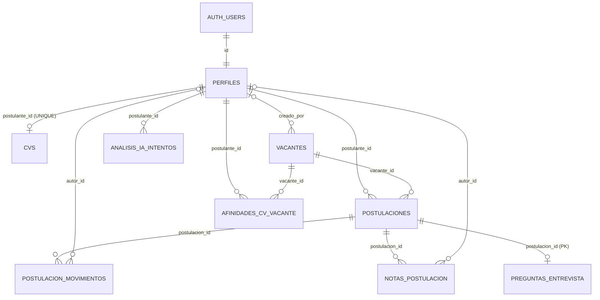

# D. Modelo de datos completo

Fuente: catálogo de PostgreSQL del proyecto desplegado (consultas de solo lectura del 5/11/2026), contrastado con `supabase/migrations/*.sql`. Todas las filas de esta sección están **[V]** salvo indicación.

## D.1 Inventario de tablas y función de negocio

| Tabla | Función en el negocio | Filas (conteo real) |
|---|---|---|
| `perfiles` | Una fila por cuenta de `auth.users`: nombre, apellido, email y **rol** (postulante o reclutador) | 9 (8 postulantes, 1 reclutador) |
| `vacantes` | Puestos publicados por reclutadores; `activa` decide si los postulantes la ven | 6 (todas activas) |
| `cvs` | CV de cada postulante: referencia al PDF y resultado del análisis (resumen y perfil estructurado) | 7 (todos en estado `listo`) |
| `postulaciones` | Entidad asociativa persona–vacante, con la **etapa** del proceso | 6 (4 nuevo, 1 entrevista, 1 descartado) |
| `afinidades_cv_vacante` | Resultado de la IA: afinidad 0 a 100 y motivos de cada CV con cada vacante abierta (incluye las vacantes a las que la persona se postuló). **Única fuente de verdad** de los resultados de IA | 25 |
| `analisis_ia_intentos` | Un registro por análisis pedido; sirve para el tope diario por persona | 13 |
| `postulacion_movimientos` | Historial de cambios de etapa (escrito por un disparador) | 2 |
| `notas_postulacion` | Notas internas del equipo de selección | 0 |
| `preguntas_entrevista` | Preguntas de entrevista sugeridas por la IA (una fila por postulación) | 1 |

Además existe el esquema `respaldo` con 9 copias de estas tablas (ver D.9). Los conteos salen de `count(*)` reales; la estadística `n_live_tup` de PostgreSQL mostraba 0 en varias tablas y **no es confiable** a este volumen.

## D.2 Columnas, tipos y restricciones por tabla

Notación: **PK** clave primaria, **FK** clave foránea (con política `ON DELETE`), **NN** `NOT NULL`, **U** `UNIQUE`, **CK** `CHECK`.

### perfiles
| Columna | Tipo | Restricciones |
|---|---|---|
| `id` | uuid | **PK**; **FK → `auth.users(id)` ON DELETE CASCADE** |
| `nombre` | text | NN, default `''` |
| `apellido` | text | NN, default `''` |
| `email` | text | NN (copia de `auth.users.email`; no es UNIQUE en esta tabla) |
| `rol` | text | NN, default `'postulante'`, **CK** `rol IN ('postulante','reclutador')` (`perfiles_rol_check`) |
| `creado_en` | timestamptz | NN, default `now()` |

### vacantes
| Columna | Tipo | Restricciones |
|---|---|---|
| `id` | uuid | **PK**, default `gen_random_uuid()` |
| `titulo` | text | NN, **CK** `length(trim(titulo)) > 0` (`vacantes_titulo_check`) |
| `descripcion`, `requisitos`, `habilidades`, `informacion_adicional` | text | NN, default `''` (sin límite de largo) |
| `activa` | boolean | NN, default `true` |
| `creado_por` | uuid | default `auth.uid()`; **FK → `perfiles(id)` ON DELETE SET NULL** |
| `creado_en` | timestamptz | NN, default `now()` |
| `actualizado_en` | timestamptz | NN, default `now()` (lo actualiza el disparador `vacantes_registrar_cambios`) |
| `cerrada_en` | timestamptz | nullable (la fija el mismo disparador al desactivar) |

### cvs
| Columna | Tipo | Restricciones |
|---|---|---|
| `id` | uuid | **PK**, default `gen_random_uuid()` |
| `postulante_id` | uuid | NN, **U** (`cvs_postulante_id_key`), **FK → `perfiles(id)` ON DELETE CASCADE** |
| `ruta_archivo` | text | NN, **CK** `ruta_archivo = postulante_id::text || '/cv.pdf'` (`cvs_ruta_propia`) |
| `nombre_archivo` | text | NN |
| `subido_en` | timestamptz | NN, default `now()` |
| `perfil_estructurado` | jsonb | nullable (salida de la IA) |
| `resumen` | text | nullable (salida de la IA) |
| `analisis_estado` | text | NN, default `'pendiente'`, **CK** en `('pendiente','analizando','listo','error')` |
| `analisis_iniciado_en`, `analizado_en` | timestamptz | nullable; **CK** `analisis_estado <> 'listo' OR analizado_en IS NOT NULL` (`cvs_listo_con_fecha`) |

### postulaciones
| Columna | Tipo | Restricciones |
|---|---|---|
| `id` | uuid | **PK** |
| `vacante_id` | uuid | NN, **FK → `vacantes(id)` ON DELETE CASCADE** |
| `postulante_id` | uuid | NN, default `auth.uid()`, **FK → `perfiles(id)` ON DELETE CASCADE** |
| `creado_en` | timestamptz | NN, default `now()` |
| `etapa` | text | NN, default `'nuevo'`, **CK** en `('nuevo','preseleccionado','entrevista','finalista','contratado','descartado')` |
| `etapa_actualizada_en` | timestamptz | NN, default `now()` (la mantiene el disparador `postulaciones_registrar_etapa`) |
| — | — | **U** `(vacante_id, postulante_id)` (`postulaciones_unica`) |

### afinidades_cv_vacante
| Columna | Tipo | Restricciones |
|---|---|---|
| `id` | uuid | **PK** |
| `vacante_id` | uuid | NN, **FK → `vacantes(id)` ON DELETE CASCADE** |
| `postulante_id` | uuid | NN, **FK → `perfiles(id)` ON DELETE CASCADE** |
| `afinidad` | smallint | nullable, **CK** `afinidad BETWEEN 0 AND 100` |
| `creado_en` | timestamptz | NN, default `now()` |
| `analisis` | jsonb | nullable, **CK** objeto o nulo (`coincide`, `inferido`, `falta`, `conclusion`) |
| `modelo` | text | nullable (trazabilidad del modelo; **las 25 filas actuales lo tienen en NULL**) |
| — | — | **U** `(vacante_id, postulante_id)` (`afinidades_cv_vacante_unico`) |

### analisis_ia_intentos
`id` uuid **PK**; `postulante_id` uuid NN **FK → perfiles ON DELETE CASCADE**; `creado_en` timestamptz NN default `now()`.

### postulacion_movimientos
`id` uuid **PK**; `postulacion_id` uuid NN **FK → postulaciones ON DELETE CASCADE**; `etapa_anterior` text NN; `etapa_nueva` text NN (**sin CHECK** de valores; solo escribe el disparador); `autor_id` uuid default `auth.uid()` **FK → perfiles ON DELETE SET NULL**; `creado_en` timestamptz NN default `now()`.

### notas_postulacion
`id` uuid **PK**; `postulacion_id` uuid NN **FK → postulaciones ON DELETE CASCADE**; `autor_id` uuid default `auth.uid()` **FK → perfiles ON DELETE SET NULL**; `texto` text NN **CK** longitud 1 a 2000; `creado_en` timestamptz NN default `now()`.

### preguntas_entrevista
`postulacion_id` uuid **PK** y **FK → postulaciones ON DELETE CASCADE** (relación 1 a 0..1); `preguntas` jsonb NN **CK** `jsonb_typeof = 'array'`; `generado_en` timestamptz NN default `now()`; `modelo` text nullable.

## D.3 Índices y justificación

| Tabla | Índice | Columnas | Justificación (consulta que lo usa) | ¿Usado hoy? |
|---|---|---|---|---|
| todas | `*_pkey` | `id` (o `postulacion_id`) | Clave primaria | Sí |
| `cvs` | `cvs_postulante_id_key` | `postulante_id` (UNIQUE) | Un CV por persona; `registrarCv` hace upsert por esa columna (`acciones/cv.ts:27`) y `analizarCv` busca por `postulante_id` (`analizar.ts:41-45`) | Sí |
| `postulaciones` | `postulaciones_unica` | `(vacante_id, postulante_id)` | Impide duplicados; sirve también las búsquedas por vacante | Sí |
| `postulaciones` | `postulaciones_postulante_idx` | `postulante_id` | "Mis postulaciones" (`postulante/mis-postulaciones/page.tsx:19`) y políticas RLS | Sí (según el asesor) |
| `postulaciones` | `postulaciones_etapa_idx` | `(etapa, etapa_actualizada_en)` | Alertas de "sin revisar" y "estancados" **si algún día se calculan en SQL**; hoy el dashboard calcula en la aplicación | **No** (aviso "unused_index") |
| `afinidades_cv_vacante` | `afinidades_cv_vacante_unico` | `(vacante_id, postulante_id)` | Impide duplicados; `upsert` con `onConflict: "vacante_id,postulante_id"` (`analizar.ts:129`) | Sí |
| `afinidades_cv_vacante` | `afinidades_cv_vacante_postulante_idx` | `postulante_id` | `delete … eq("postulante_id")` (`analizar.ts:133`) y `in("postulante_id", …)` (`dashboard.ts:70-78`) | **No** (volumen mínimo) |
| `analisis_ia_intentos` | `analisis_ia_intentos_postulante_idx` | `(postulante_id, creado_en DESC)` | Conteo de las últimas 24 h (`analizar.ts:61-65`) | **No** (volumen mínimo) |
| `postulacion_movimientos` | `postulacion_movimientos_postulacion_fecha_idx` | `(postulacion_id, creado_en)` | Historial de una postulación en orden (`postulaciones/[id]/page.tsx:71`) | **No** (volumen mínimo) |
| `notas_postulacion` | `notas_postulacion_postulacion_idx` | `postulacion_id` | Notas de una postulación (`postulaciones/[id]/page.tsx:66`) | Sí (según el asesor, sin aviso) |
| `vacantes` | `vacantes_activa_idx` | `activa` | Filtro de vacantes activas; **baja selectividad** | **No** |

Lectura honesta: con 6 vacantes y 6 postulaciones PostgreSQL elige recorrido secuencial y los índices "no usados" lo son por volumen, no por error de diseño. El asesor de rendimiento también señala **3 claves foráneas sin índice** (`notas_postulacion.autor_id`, `postulacion_movimientos.autor_id`, `vacantes.creado_por`), omitidas a propósito porque no se consulta por esas columnas (solo importan al borrar un perfil).

## D.4 Políticas de eliminación y actualización en cascada

| Relación (hijo → padre) | ON DELETE | Efecto práctico |
|---|---|---|
| `perfiles.id → auth.users.id` | CASCADE | Borrar la cuenta borra el perfil |
| `cvs.postulante_id → perfiles` | CASCADE | Se borra el CV (fila), **no el PDF** (lo limpia el cron) |
| `postulaciones.postulante_id → perfiles` | CASCADE | Se borran sus postulaciones |
| `postulaciones.vacante_id → vacantes` | CASCADE | **Borrar una vacante borra todas sus postulaciones** (y, en cascada, movimientos, notas y preguntas) |
| `afinidades_cv_vacante.* → vacantes / perfiles` | CASCADE | Se borran los resultados de IA |
| `analisis_ia_intentos.postulante_id → perfiles` | CASCADE | |
| `postulacion_movimientos.postulacion_id`, `notas_postulacion.postulacion_id`, `preguntas_entrevista.postulacion_id` | CASCADE | |
| `vacantes.creado_por`, `notas_postulacion.autor_id`, `postulacion_movimientos.autor_id → perfiles` | SET NULL | Se conserva el registro aunque se borre a su autor |

No hay `ON UPDATE CASCADE`: las claves primarias son `uuid` inmutables, no se actualizan.

## D.5 Disparadores y funciones

| Objeto | Definición | Función |
|---|---|---|
| `al_crear_usuario` | `AFTER INSERT ON auth.users … EXECUTE crear_perfil_nuevo_usuario()` | Crea el perfil con rol fijo `'postulante'` (`20260924120000_perfiles.sql:44-66`) |
| `al_cambiar_email_usuario` | `AFTER UPDATE OF email ON auth.users WHEN (old.email IS DISTINCT FROM new.email)` | Sincroniza `perfiles.email` (`20261105120000…:107-125`) |
| `cvs_al_reemplazar` | `BEFORE UPDATE ON cvs … cvs_limpiar_analisis()` | Si cambia `ruta_archivo` o `subido_en`, vacía el análisis anterior y el estado (`20261015120000…`, redefine la versión de `20260924140000_cvs.sql:22-39`) |
| `postulaciones_registrar_etapa` | `BEFORE UPDATE ON postulaciones` | Si cambia `etapa`: actualiza `etapa_actualizada_en` e inserta un movimiento (`SECURITY DEFINER`) |
| `vacantes_registrar_cambios` | `BEFORE UPDATE ON vacantes` | `actualizado_en := now()`; `cerrada_en` al desactivar; la limpia al reactivar |

Funciones del esquema `public`: `es_reclutador()` (STABLE, SECURITY DEFINER, `search_path` vacío), `crear_perfil_nuevo_usuario()`, `sincronizar_email_perfil()`, `postulaciones_registrar_etapa()` (todas SECURITY DEFINER), `cvs_limpiar_analisis()` y `vacantes_registrar_cambios()` (SECURITY INVOKER). Además hay disparadores propios de Supabase sobre `storage.buckets` y `storage.objects` (no son del proyecto).

## D.6 Vínculo con Supabase Auth

- `perfiles.id` **es** el `id` de `auth.users` (PK y FK a la vez, CASCADE). `postulante_id`, `creado_por` y `autor_id` toman por defecto `auth.uid()`.
- La creación del perfil es **atómica con el alta** de la cuenta (disparador `AFTER INSERT` en `auth.users`).
- Si un usuario existiera sin perfil, la app muestra "Tu cuenta no tiene perfil" (`src/app/page.tsx:17-27`). Control real: **0 usuarios sin perfil**.
- El rol **no** está en `user_metadata` del JWT sino en la tabla `perfiles`: así un usuario no puede alterar su rol modificando sus metadatos.

## D.7 Representación textual exacta del modelo (para el diagrama E-R)

**Entidades (atributos; PK subrayada con `*`, FK con `→`):**

```
AUTH_USERS(id*, email, …)                                  [esquema auth de Supabase]
PERFILES(id* →AUTH_USERS.id, nombre, apellido, email, rol, creado_en)
VACANTES(id*, titulo, descripcion, requisitos, habilidades, informacion_adicional,
         activa, creado_por →PERFILES.id, creado_en, actualizado_en, cerrada_en)
CVS(id*, postulante_id →PERFILES.id [UNIQUE], ruta_archivo, nombre_archivo, subido_en,
    perfil_estructurado, resumen, analisis_estado, analisis_iniciado_en, analizado_en)
POSTULACIONES(id*, vacante_id →VACANTES.id, postulante_id →PERFILES.id, creado_en,
              etapa, etapa_actualizada_en)             [UNIQUE(vacante_id, postulante_id)]
AFINIDADES_CV_VACANTE(id*, vacante_id →VACANTES.id, postulante_id →PERFILES.id,
                      afinidad, creado_en, analisis, modelo)
                                                       [UNIQUE(vacante_id, postulante_id)]
ANALISIS_IA_INTENTOS(id*, postulante_id →PERFILES.id, creado_en)
POSTULACION_MOVIMIENTOS(id*, postulacion_id →POSTULACIONES.id, etapa_anterior, etapa_nueva,
                        autor_id →PERFILES.id, creado_en)
NOTAS_POSTULACION(id*, postulacion_id →POSTULACIONES.id, autor_id →PERFILES.id, texto, creado_en)
PREGUNTAS_ENTREVISTA(postulacion_id* →POSTULACIONES.id, preguntas, generado_en, modelo)
```

**Relaciones (cardinalidad y participación; "total" = la FK es NOT NULL):**

| Relación | Cardinalidad | Participación |
|---|---|---|
| AUTH_USERS — PERFILES | 1 a 1 | total en PERFILES |
| PERFILES — CVS | 1 a 0..1 | parcial en PERFILES, total en CVS |
| PERFILES (reclutador) — VACANTES ("crea") | 1 a 0..N | parcial (`creado_por` nullable) |
| PERFILES — POSTULACIONES ("se postula") | 1 a 0..N | total en POSTULACIONES |
| VACANTES — POSTULACIONES ("recibe") | 1 a 0..N | total en POSTULACIONES |
| (PERFILES, VACANTES) vía POSTULACIONES | N a M, resuelta, UNIQUE del par | — |
| PERFILES — AFINIDADES_CV_VACANTE | 1 a 0..N | total en AFINIDADES |
| VACANTES — AFINIDADES_CV_VACANTE | 1 a 0..N | total en AFINIDADES |
| (PERFILES, VACANTES) vía AFINIDADES | N a M, resuelta, UNIQUE del par | — |
| PERFILES — ANALISIS_IA_INTENTOS | 1 a 0..N | total |
| POSTULACIONES — POSTULACION_MOVIMIENTOS | 1 a 0..N | total |
| POSTULACIONES — NOTAS_POSTULACION | 1 a 0..N | total |
| POSTULACIONES — PREGUNTAS_ENTREVISTA | 1 a 0..1 | total en PREGUNTAS |
| PERFILES — NOTAS_POSTULACION / POSTULACION_MOVIMIENTOS ("autor") | 1 a 0..N | parcial (nullable) |

**Mermaid equivalente** (se puede pegar en mermaid.live):



## D.8 Normalización, redundancias y desnormalizaciones

| Elemento | Tipo | Valoración |
|---|---|---|
| Resultados de IA | Antes duplicados en dos tablas; **hoy una sola** (`afinidades_cv_vacante`) | Resuelto el 5/11/2026; verificado (las columnas `afinidad`, `analisis`, `vacante_sugerida_id` ya no existen en `postulaciones`) |
| `perfiles.email` | Copia de `auth.users.email` | Necesaria (la app no lee `auth`); sincronizada por disparador; **0 diferencias** hoy |
| `cvs.ruta_archivo` | Atributo derivable de `postulante_id` (`<id>/cv.pdf`) | Redundante a propósito (la CHECK impone la igualdad); simplifica Storage |
| `postulaciones.etapa` y `postulacion_movimientos.etapa_nueva` | El estado actual coincide con el último movimiento | Redundancia de rendimiento/auditoría, justificada |
| `cvs.resumen` y `cvs.perfil_estructurado` | Datos derivados de la IA, guardados como caché | Aceptable; se vacían al reemplazar el CV |
| `afinidades_cv_vacante.analisis` (JSON con listas) | No normalizado (motivos como arreglo JSON) | Adecuado para texto de la IA; impide consultas SQL sobre cada motivo |
| `vacantes.requisitos` y `habilidades` | Texto libre, no catálogo | Limita el matching estructurado; decisión de simplicidad |

El modelo está en **3FN** salvo las redundancias de la tabla (todas deliberadas).

## D.9 Diferencias entre repositorio y base desplegada

| Aspecto | Repositorio | Base desplegada | Impacto |
|---|---|---|---|
| Tablas, columnas, restricciones, índices, políticas, disparadores | 11 migraciones | **Coinciden** (verificado) | Ninguno |
| Registro de migraciones | 11 archivos | 4 registradas: `perfiles`, `vacantes`, `cvs` (versiones `20260924…`) y `revocar_ejecucion_trigger` (`20261105123648`) | Si se usara la CLI de Supabase (`db push`) la base y el repositorio aparecerían desincronizados (L-7) |
| Versión de la migración de seguridad | `20261105130000` | `20261105123648` | Mismo contenido, distinta versión |
| Esquema `respaldo` | Solo el script `supabase/scripts/respaldo_antes_de_optimizar.sql` | 9 tablas copiadas | Contiene datos personales duplicados; protegido por RLS sin políticas |
| Columna `modelo` en resultados | Escrita por `analizar.ts:109` y `preguntas.ts` | **NULL en las 25 filas** y en la fila de preguntas | Aún no se ejecutó un análisis con el código nuevo (ver F.G) |

## D.10 Riesgos de integridad y diseño

1. **Borrado en cascada destructivo:** eliminar una vacante borra postulaciones, historial, notas y preguntas (por diseño; la interfaz lo advierte y exige confirmación, `BotonEliminarVacante.tsx`). No hay borrado lógico (L-13).
2. **Sin FK entre `cvs` y Storage:** puede haber archivos sin fila o filas sin archivo; hoy 0 de ambos; el cron corrige los huérfanos de archivo (con un defecto latente, L-2).
3. **`postulacion_movimientos.etapa_*` sin CHECK:** valores libres (solo escribe el disparador).
4. **Sin límites de largo en los textos de `vacantes`.**
5. **`perfiles.email` sin UNIQUE** (la unicidad la da `auth.users`).
6. **Permisos de INSERT sobre columnas automáticas de `vacantes`:** el rol `authenticated` tiene `INSERT` a nivel de tabla, por lo que un reclutador podría fijar `cerrada_en` o `actualizado_en` al crear una vacante (los disparadores solo actúan en `UPDATE`). Impacto mínimo (solo reclutadores).
7. **Sin auditoría de quién edita o desactiva una vacante** (solo "cuándo").
