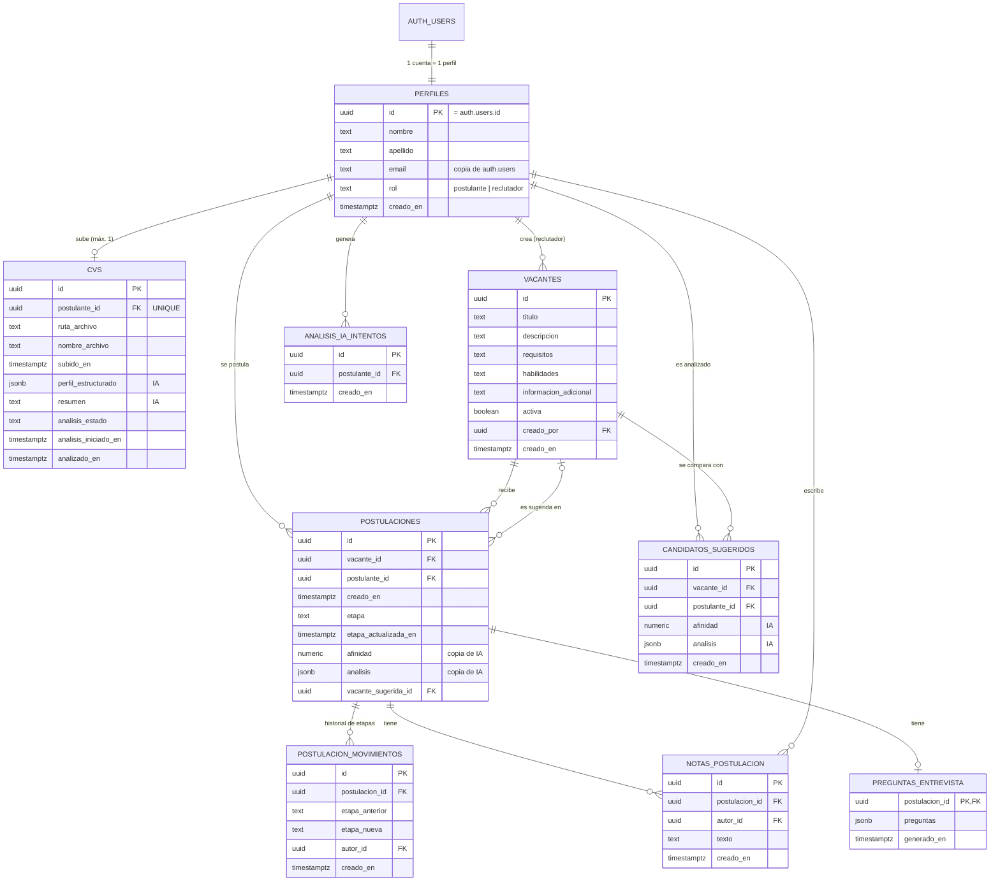
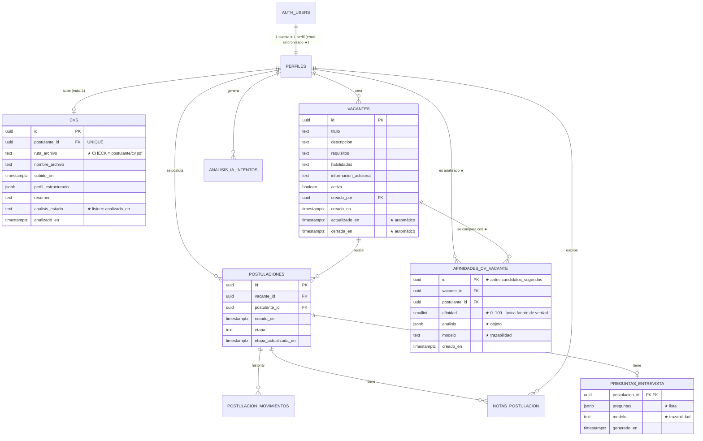

# Base de datos de Grupo Cumbre: ingeniería inversa, diagnóstico y optimización

Documento de análisis del modelo de datos de la plataforma de reclutamiento (Supabase / PostgreSQL).
Los diagramas están en formato Mermaid: GitHub los dibuja automáticamente.

> **Cómo se hizo la ingeniería inversa.** Se reconstruyó el esquema aplicando las 8 migraciones versionadas en un
> PostgreSQL 16 de prueba y se lo inspeccionó con consultas al catálogo del sistema (`information_schema`,
> `pg_constraint`, `pg_indexes`, `pg_policies`). Después se contrastó con el código de la aplicación (qué consulta,
> escribe y borra cada tabla). **Pendiente de confirmar:** que la base *desplegada* en Supabase coincide con las
> migraciones (ver sección 9).

---

## 1. MER original (antes de optimizar)

**Cardinalidades y reglas ya presentes**

| Relación | Cardinalidad | Borrado |
|---|---|---|
| `auth.users` → `perfiles` | 1 a 1 | cascada |
| `perfiles` → `cvs` | 1 a 0..1 (`UNIQUE`) | cascada |
| `vacantes` ↔ `perfiles` (postulaciones) | N a M resuelta con `postulaciones`, `UNIQUE (vacante, postulante)` | cascada |
| `vacantes` → `postulaciones.vacante_sugerida_id` | 1 a 0..N | `SET NULL` |
| `vacantes` ↔ `perfiles` (candidatos_sugeridos) | N a M, `UNIQUE (vacante, postulante)` | cascada |
| `postulaciones` → movimientos / notas / preguntas | 1 a N / 1 a N / 1 a 0..1 | cascada |
| `vacantes.creado_por`, `notas.autor_id`, `movimientos.autor_id` → `perfiles` | N a 1 | `SET NULL` (se conserva el dato aunque se borre a la persona) |

---

## 2. Diagnóstico

### Lo que está bien diseñado (y se conserva)
- **Claves:** todas las tablas usan `uuid` como clave primaria; `preguntas_entrevista` usa la clave foránea como PK (relación 1 a 0..1 bien modelada).
- **Integración con `auth.users`:** `perfiles.id` es a la vez PK y FK de `auth.users` con cascada; un disparador crea el perfil al registrarse y **siempre** como `postulante` (nadie puede elegir ser reclutador).
- **Integridad referencial completa** y con la política de borrado pensada caso por caso (`CASCADE` para datos que dependen del padre, `SET NULL` para autores y vacante sugerida).
- **Unicidad de negocio en la base** (una postulación por persona y vacante, un CV por persona), no solo en el código.
- **Seguridad:** RLS activado en las 9 tablas, permisos **por columna** (`GRANT UPDATE (etapa)`, etc.) y función `es_reclutador()` (`SECURITY DEFINER`, `search_path` vacío). Los resultados de IA solo los escribe el servidor.
- **Historial por disparador:** los cambios de etapa los registra la base (no se puede olvidar ni falsear desde la app).
- **Estados con `CHECK`** (`rol`, `etapa`, `analisis_estado`) y `timestamptz` en todas las fechas.

### Problemas y oportunidades detectados

| # | Hallazgo | Impacto | Prioridad | Estado |
|---|---|---|---|---|
| H1 | `afinidad` es `numeric` **sin límites**: la base aceptaría -5, 250 o 55,37; solo el código lo impide. | Integridad | Alta | **Resuelto** (M1) |
| H2 | Reglas de negocio que solo existen en el código o en RLS (que el servidor se salta): vacante sugerida distinta de la postulada, ruta del CV propia, "listo" con fecha, forma de los JSON. | Integridad | Alta | **Resuelto** (M2) |
| H3 | Claves foráneas y consultas frecuentes sin índice: `vacante_sugerida_id`, `candidatos_sugeridos.postulante_id`, alertas por etapa, historial por fecha. Borrar una vacante recorría toda la tabla de postulaciones. | Eficiencia / escalabilidad | Media | **Resuelto** (M3) |
| H4 | Las vacantes solo tienen `activa`: **no se puede calcular cuánto estuvo abierta una vacante** ni cuándo se editó. | Indicadores | Media | **Resuelto** (M4) |
| H5 | `perfiles.email` es copia de `auth.users.email` y solo se copiaba al registrarse: si la cuenta cambia de email, quedan distintos. | Consistencia | Media | **Resuelto** (M5) |
| H6 | Los resultados de IA se **reemplazan** en cada análisis y no guardan qué modelo los calculó: no hay trazabilidad (clave para auditar decisiones asistidas por IA en selección de personal). | Trazabilidad | Media | **Resuelto** (M6) |
| H7 | El esquema no tenía documentación dentro de la base. | Mantenimiento | Baja | **Resuelto** (M7) |
| H8 | **Duplicación de datos derivados:** `postulaciones.afinidad / analisis` son una copia de `candidatos_sugeridos` que el código sincroniza. Hay dos fuentes de verdad y riesgo de que diverjan. | Normalización | Alta | **Resuelto** (M8) |
| H9 | **Exposición de datos internos al candidato:** como la afinidad, el análisis de IA y la etapa viven en `postulaciones` y el postulante puede leer sus propias filas, la API le permitiría ver su puntaje, la evaluación de la IA y si fue "descartado". La pantalla no lo muestra, pero la base sí lo permite. | Seguridad / privacidad | Alta | **Resuelto** (M8): los resultados de IA ya no son legibles por el postulante. La etapa sí lo es, a propósito (es su propio estado en el proceso). |
| H10 | **Nombre engañoso:** `candidatos_sugeridos` guarda la afinidad de *cada* CV con *cada* vacante abierta, incluidas aquellas a las que la persona sí se postuló; no son solo "sugeridos". | Claridad | Baja | **Resuelto** (M8) |
| H11 | Al borrar una cuenta (o su perfil) se borran sus datos en cascada, pero **el PDF queda en el bucket** `cvs` (archivo huérfano). | Privacidad / limpieza | Media | **Resuelto** (M9) |
| H12 | `analisis_ia_intentos` crece sin límite (solo se usa la ventana de 24 h). | Mantenimiento | Baja | **Resuelto** (M9) |
| H13 | El dashboard descarga todas las postulaciones y calcula los indicadores en la aplicación. Funciona con cientos de filas; con miles conviene calcular en SQL (vistas o funciones). | Escalabilidad | Baja hoy | **Parcial** (M10): paginación hecha; cálculo en SQL diferido |

### Decisiones evaluadas y **no** cambiadas (a propósito)
- **Etapas como tabla de catálogo en vez de `CHECK`:** no se justifica con 6 valores fijos que además definen el flujo de la app; una tabla agregaría un `JOIN` y un lugar más donde mantenerlas.
- **Rol como tabla / enumerado:** hay solo dos roles y `CHECK` basta. Un tercer rol "gerente" **no existe**: el equipo definió que el gerente es la propia reclutadora.
- **Tabla separada de "candidatos":** `perfiles` + `cvs` ya los representa sin duplicar; separar crearía una entidad redundante.
- **Más tablas de entrevistas / tareas:** no son parte de la funcionalidad actual; no se agregan "por si acaso".
- **Índice sobre `vacantes.activa`:** ya existe; con pocas vacantes no aporta mucho, pero no perjudica.

---

## 3. Mejoras implementadas (migración `20261105120000_optimizacion_modelo.sql`)

Todas son **aditivas o endurecen reglas que los datos actuales ya cumplen**. No se borra ninguna tabla, columna ni dato. Todo corre en **una transacción**: si algo falla, no se aplica nada.

| Id | Cambio | Qué problema resolvía | Por qué es mejor |
|---|---|---|---|
| M1 | `afinidad`: `numeric` → `smallint` con `CHECK (0..100)` en `postulaciones` y `candidatos_sugeridos`. | H1: valores imposibles aceptados. | El dominio (entero 0–100) lo garantiza la base; ocupa menos y no depende de que el código se acuerde de validar. |
| M2 | `CHECK`: `vacante_sugerida_id <> vacante_id`; `cvs.ruta_archivo = postulante_id/cv.pdf`; `analisis_estado='listo'` ⇒ `analizado_en` no nulo; JSON de análisis = objeto y de preguntas = lista. | H2: reglas que solo cumplía el código o RLS. | El servidor usa la clave secreta y **se salta RLS**: con estas restricciones ni un bug del servidor puede dejar datos incoherentes. |
| M3 | Índices: `postulaciones(vacante_sugerida_id)` (parcial), `candidatos_sugeridos(postulante_id)`, `postulaciones(etapa, etapa_actualizada_en)`, `postulacion_movimientos(postulacion_id, creado_en)` (reemplaza al simple). | H3: recorridos completos de tabla. | Cada índice responde a una consulta real de la app (borrar vacante, re-análisis por persona, alertas del dashboard, historial ordenado). El índice simple del historial quedó redundante y se eliminó. |
| M4 | `vacantes.actualizado_en` y `vacantes.cerrada_en` mantenidos por disparador. | H4: sin fechas no hay "tiempo de cobertura" ni auditoría de cambios. | Habilita indicadores (días abiertas) sin agregar trabajo a la app. En las vacantes ya inactivas `cerrada_en` queda **vacío**: esa fecha nunca se registró y no se inventa. |
| M5 | Disparador `auth.users.email` → `perfiles.email`. | H5: copias que divergen. | La redundancia (necesaria porque la app no lee `auth.users`) queda sincronizada automáticamente. |
| M6 | `modelo` en `candidatos_sugeridos` y `preguntas_entrevista` (la app lo completa). | H6: sin trazabilidad. | Permite saber con qué modelo se calculó cada resultado y comparar modelos. Los resultados anteriores quedan con `NULL`. |
| M7 | `COMMENT ON` en tablas y columnas clave. | H7: sin documentación en la base. | El significado de cada tabla/columna se ve desde Supabase y desde cualquier herramienta de diagramas. |

### Fase 2 (migración `20261112120000_resultados_ia_una_sola_fuente.sql`) y mantenimiento

| Id | Cambio | Qué problema resolvía | Por qué es mejor |
|---|---|---|---|
| M8 | Los resultados de IA viven **solo** en `afinidades_cv_vacante` (antes `candidatos_sugeridos`). Se eliminan `postulaciones.afinidad`, `analisis` y `vacante_sugerida_id`. La "otra vacante sugerida" se **calcula al mostrarla** (`src/lib/ia/sugerencia.ts`) con las reglas de `config.ts`. Antes de eliminar las columnas, la migración copia a la tabla única cualquier afinidad que solo existiera en `postulaciones`. | H8, H9, H10: dos fuentes de verdad sincronizadas por código, el postulante podía leer su puntaje y evaluación, y un nombre engañoso. | Una sola fuente de verdad (se elimina el código de sincronización y la posibilidad de divergir). El postulante ya no puede leer resultados de IA (RLS de solo reclutador). La sugerencia nunca queda desactualizada ni apunta a una vacante ya cerrada. El nombre dice lo que contiene. |
| M9 | Limpieza diaria `/api/limpieza` (Vercel Cron, protegida con `CRON_SECRET`): borra del bucket los PDF sin CV en la base (de más de 1 hora) y los intentos de IA de más de 30 días. | H11 (archivos huérfanos al borrar cuentas: SQL no puede borrar archivos de Storage) y H12 (tabla de intentos sin límite). | Cumple el derecho a eliminación de datos y evita crecimiento indefinido, sin extensiones adicionales de Postgres. |
| M10 | Todas las cargas grandes (postulaciones, afinidades, movimientos, estados de CV) se piden **por páginas** (`traerTodo`). | H13: Supabase devuelve como máximo 1000 filas por consulta; con más, los indicadores habrían salido incompletos **sin ningún aviso**. | Corrección garantizada a cualquier volumen. El cálculo de indicadores directamente en SQL (vistas o funciones) se difiere: no hace falta hasta decenas de miles de postulaciones y duplicaría las reglas de `config.ts`. |

**Cambio de código asociado (M6):** `src/lib/ia/analizar.ts` y `src/lib/ia/preguntas.ts` guardan `modelo`. Fase 2: ver tabla anterior (`cargarPostulaciones` lee de la tabla única y calcula la sugerencia; `analizar.ts` guarda con `upsert` y quita las vacantes que ya no se compararon, sin dejar un momento sin datos).

---

## 4. MER optimizado (después de M1–M10)

Los cambios respecto del original están marcados con **★**.

(`PERFILES`, `ANALISIS_IA_INTENTOS`, `POSTULACION_MOVIMIENTOS` y `NOTAS_POSTULACION` no cambian de columnas; sí cambian los índices de `POSTULACION_MOVIMIENTOS`. `POSTULACIONES` quedó **solo con datos del proceso**: ya no tiene `afinidad`, `analisis` ni `vacante_sugerida_id`, y desaparece la relación "es sugerida en".)

---

## 5. Comparación antes y después

| Aspecto | Antes | Después |
|---|---|---|
| Rango de la afinidad | Solo lo exigía el código | `smallint` + `CHECK 0..100` en la base |
| Reglas de negocio en la base | Estados y unicidad | + vacante sugerida distinta, ruta de CV propia, "listo" con fecha, forma de los JSON |
| Índices | PK/UNIQUE + 4 simples | + 2 nuevos y 1 compuesto que reemplaza a uno simple (y 1 parcial que luego desaparece con la Fase 2) |
| Fechas de vacantes | Solo `creado_en` y `activa` | + `actualizado_en` y `cerrada_en` automáticos |
| `perfiles.email` vs `auth.users` | Divergen si cambia el email | Sincronizados por disparador |
| Trazabilidad de IA | Ninguna | `modelo` en cada resultado |
| Resultados de IA | Duplicados en 2 tablas, legibles por el postulante | Una sola tabla (`afinidades_cv_vacante`), solo reclutador |
| Archivos de CV de cuentas borradas | Quedaban en el bucket | Limpieza diaria automática |
| Cargas grandes | Truncadas silenciosamente a 1000 filas | Paginadas |
| Documentación en la base | Ninguna | `COMMENT ON` en tablas y columnas clave |
| Tablas / columnas borradas | — | **Ninguna** |

### ¿Puede el modelo respaldar los indicadores de los dashboards?

| Indicador | ¿Se puede calcular? | Con qué |
|---|---|---|
| Postulaciones por semana / período | Sí | `postulaciones.creado_en` |
| Embudo por etapa | Sí | `postulaciones.etapa` |
| Tiempo hasta la primera revisión | Sí | `postulacion_movimientos` (primer cambio) − `postulaciones.creado_en` |
| Tiempo en la etapa actual / procesos estancados | Sí | `etapa_actualizada_en` |
| Tiempo hasta contratar (*time-to-hire*) | Sí | movimiento a `contratado` − `creado_en` |
| Días que estuvo abierta una vacante | **Sí, desde M4** (solo para cierres futuros) | `cerrada_en − creado_en` |
| Afinidad promedio y buen match | Sí | `postulaciones.afinidad` |
| Valor extra de la IA (recomendaciones sin postular) | Sí | `candidatos_sugeridos` − `postulaciones` |
| Motivos de descarte | **No** (no se registra el motivo) | Requeriría una columna; solo vale la pena si el negocio lo va a usar |

---

## 6. Pendiente (decisiones conscientes)

- **Cálculo de indicadores directamente en SQL (vistas / funciones).** Hoy se calculan en la aplicación sobre las filas traídas por páginas. Es correcto a cualquier volumen; solo se volvería lento con decenas de miles de postulaciones. Se difiere para no duplicar en SQL los umbrales de `config.ts`.
- **Motivo de descarte.** No se registra (ver tabla de indicadores). Solo conviene agregarlo si el negocio lo va a usar.
- **La etapa es legible por el propio postulante** (incluye "descartado"). Es una decisión de producto: su estado es suyo y permitiría un futuro seguimiento de su candidatura. Si se prefiere ocultarla, habría que moverla a otra tabla.

---

## 7. Validación realizada

Entorno de prueba: PostgreSQL 16 con las 8 migraciones anteriores + datos de ejemplo (3 perfiles, 2 vacantes, 2 CV, 2 postulaciones, sugeridos, notas, preguntas), con roles `anon` / `authenticated` / `service_role` simulados.

- **Migración aplicada sobre datos existentes:** sin pérdida de filas (el control del respaldo coincide en las 9 tablas); `afinidad` pasó de `numeric` a `smallint` conservando el valor; las vacantes existentes quedaron con `actualizado_en = creado_en` y `cerrada_en` vacío.
- **Integridad:** las 8 reglas nuevas **rechazan** datos inválidos (afinidad 250 y -1, sugerida = postulada, ruta de CV ajena, "listo" sin fecha, JSON de forma incorrecta) y **aceptan** los válidos (73,6 se guarda como 74).
- **Disparadores:** al desactivar una vacante se carga `cerrada_en`; al reactivarla vuelve a nulo; al editar avanza `actualizado_en`; al cambiar el email en `auth.users` el perfil se actualiza.
- **Seguridad (RLS y permisos):** el postulante **no** puede modificar `cerrada_en`, `activa`, `etapa`; no ve notas ni resultados sugeridos; `anon` no accede a nada. Sin cambios respecto de antes.
- **Compatibilidad:** el borrado de vacantes sigue en cascada (postulaciones y sugeridos) y deja en `NULL` las vacantes sugeridas. La aplicación no cambia ninguna consulta existente; solo agrega `modelo` al guardar resultados. Comprobaciones de la aplicación: `tsc`, `eslint` y `next build` sin errores, y las pruebas de navegador y de IA pasan.
- **Fase 2 sobre datos existentes:** la tabla se renombra y las restricciones, el índice y la política conservan su sentido (se verificó el listado completo); una afinidad que solo estaba en `postulaciones` se copió a la tabla única antes de eliminar las columnas; el respaldo sigue conteniendo los valores originales. El postulante lee **0** resultados de IA, el reclutador los ve, `anon` no accede y borrar una vacante sigue eliminando sus resultados en cascada.
- **Pruebas de la aplicación con la estructura nueva:** 17 comprobaciones de la Fase 2 (ficha, listas, recomendaciones, comparador, análisis con `upsert` y `modelo`, postulación sin copia) y 7 de la limpieza (borra el PDF huérfano y los intentos viejos; no toca los PDF con CV ni los recién subidos; rechaza llamadas sin el secreto), más las 37 de navegación.
- **Respaldo y vuelta atrás:** `supabase/scripts/respaldo_antes_de_optimizar.sql` copia las 9 tablas a un esquema `respaldo` (no expuesto por la API). Como la migración es una sola transacción, un error no deja cambios a medias.

## 8. Qué se aplicó y qué no

| Elemento | Estado |
|---|---|
| Inspección del esquema real (`inspeccionar_esquema.sql`) | **Ejecutada en Supabase (2 pasadas, porque el editor corta a 100 filas)**: coinciden con las migraciones las 57 columnas, las 31 restricciones, los 17 índices, las 18 políticas, los 3 disparadores (incluido `al_crear_usuario` sobre `auth.users`) y el RLS activado en las 9 tablas. |
| Respaldo `respaldo_antes_de_optimizar.sql` | Preparado y validado. Se corre antes de las migraciones. |
| Migración `20261105120000_optimizacion_modelo.sql` | Preparada y validada en prueba. **Aplicación en Supabase pendiente.** |
| Migración `20261112120000_resultados_ia_una_sola_fuente.sql` | Preparada y validada en prueba. **Aplicación en Supabase pendiente.** Se publica la app inmediatamente después (la versión anterior usa columnas que esta elimina). |
| Código (tabla única, `modelo`, paginación, limpieza) | Hecho y probado; se publica después de correr las migraciones. |
| `vercel.json` + variable `CRON_SECRET` | Hecho en el repositorio; falta cargar `CRON_SECRET` en Vercel. |

## 9. Verificación contra la base desplegada

La reconstrucción parte de las migraciones. Para confirmar que la base real de Supabase **coincide**, ejecutar en el *SQL Editor* la consulta de solo lectura `supabase/scripts/inspeccionar_esquema.sql` y comparar el resultado con la sección 1 (columnas, restricciones, índices y políticas). Resultado: la base desplegada es **idéntica** a la reconstruida desde las migraciones (columnas, restricciones, índices, políticas, disparadores y RLS).

## 10. Preguntas que puede hacer el profesor

- **¿Por qué `postulaciones` es una tabla y no un campo?** Porque la relación vacante–persona es N a M y además tiene atributos propios (etapa, fechas): es una entidad asociativa.
- **¿Por qué hay datos duplicados (afinidad en dos tablas, email en dos tablas)?** El email es una copia deliberada y ahora está sincronizada; la afinidad es una desnormalización identificada (H8) con un plan de corrección (Fase 2).
- **¿Cómo se garantiza que nadie se autoasigne el rol de reclutador?** El disparador de alta fuerza `postulante`, `perfiles.rol` no tiene permiso de escritura desde la app y los reclutadores se crean a mano.
- **¿Qué pasa si se borra una vacante?** Se borran en cascada sus postulaciones y resultados de IA; los CV y las personas permanecen; las "vacantes sugeridas" que apuntaban a ella quedan en `NULL`.
- **¿Cómo se audita la IA?** Cada resultado guarda su fecha y (desde M6) el modelo; los cambios de etapa quedan en un historial inmodificable por la app; la IA solo orienta, nunca cambia etapas.
