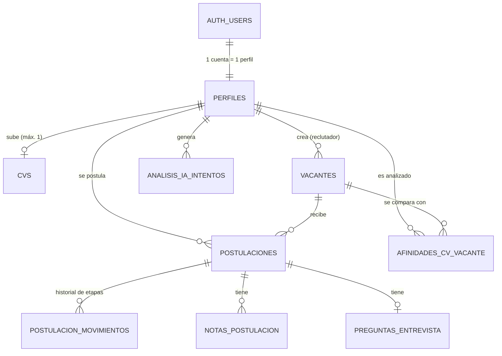

# Cuerpo de la presentación técnica: Grupo Cumbre (checklist de la consigna)

Material de trabajo para armar **una diapositiva por punto** (15 minutos: ~1 min 30 s por diapositiva).
Cada punto tiene: **mensaje clave**, **qué poner en la diapositiva**, **guion para hablar** y **visual sugerida**.

> **Cómo está marcado cada dato.** ✅ = implementado y funcionando · 🛠 = decisión de diseño/propuesta que se explica pero todavía no está aplicada · ⚠ = hay que verificarlo en el panel antes de afirmarlo (Vercel/Supabase/Anthropic).
> Todo lo marcado ✅ sale del código y las migraciones del repositorio. Lo que depende de **planes y precios** puede cambiar: verificalo en la web de cada proveedor antes de la entrega.

---

## 0. Correcciones a tu documento actual (importante, antes de armar las diapositivas)

Tu documento tiene afirmaciones que **ya no son ciertas** o que no coinciden con lo que construimos. Si las decís en la presentación y el profesor pregunta, se complica.

| En tu documento | Realidad | Qué hacer |
|---|---|---|
| "Supabase aplica automáticamente las migraciones al mergear a `main` (integración con GitHub)". | **No es así.** Las migraciones están versionadas en `supabase/migrations/` pero las corrimos **a mano** en el SQL Editor (con respaldo previo). | Decir: "las migraciones se versionan en GitHub y se aplican manualmente, con respaldo previo". Automatizarlo con la CLI/integración de Supabase queda como mejora (ver punto 8). |
| "La IA analiza el CV **cuando se realiza una postulación**". | La IA analiza el CV **apenas se sube**, y lo compara con **todas** las vacantes abiertas. Al postularse no se vuelve a llamar a la IA: la afinidad ya está calculada. | Corregir en el texto y en el diagrama de flujo. |
| Diagrama de flujo: "IA genera preguntas" automáticamente y un ciclo "reevaluar". | Las **preguntas de entrevista** se generan **a pedido** de la reclutadora (botón en la ficha). No hay ciclo: la "otra vacante sugerida" se **calcula** al mostrarla a partir de las afinidades guardadas. | Ajustar el diagrama (versión nueva en el punto 2). |
| "RLS está activado en la tabla `perfiles`" y lista solo 2 políticas. | RLS está activado en **las 9 tablas** (18 políticas), más 3 políticas en Storage, más permisos **por columna**. | Usar la tabla completa del punto 3. |
| "La app se conecta a Supabase directamente desde el navegador; la `anon key` queda expuesta". | Casi todo el acceso a datos se hace **desde el servidor** (Server Components y Server Actions de Next.js) con la sesión del usuario. El **único** uso directo desde el navegador es subir el PDF a Storage (protegido por las políticas del bucket). La clave pública se llama ahora *publishable key*. | Reescribir el párrafo (punto 3 y 7). |
| "El enlace firmado vence a los pocos minutos". | Vence a los **60 segundos**. | Precisar. |
| Funciones de la base: `crear_perfil_nuevo_usuario`, `cvs_limpiar_analisis`, `es_reclutador`. | Además hay: `postulaciones_registrar_etapa`, `vacantes_registrar_cambios`, `sincronizar_email_perfil`. | Actualizar. |
| Sección "Modelo de datos" vacía. | Ver punto 1 (ya hay análisis completo en `docs/base-de-datos.md`). | Completar. |

---

## 1. Base de datos: modelo de datos

**Mensaje clave:** 9 tablas en PostgreSQL, relacionadas por claves foráneas, con restricciones que impiden repetir o inventar datos.

**En la diapositiva**
- MER simplificado (visual abajo) + tabla resumen.
- Tablas (✅):

| Tabla | Para qué sirve | Clave primaria | Claves foráneas / únicas |
|---|---|---|---|
| `perfiles` | Una fila por cuenta: nombre, apellido, email, rol | `id` (= `auth.users.id`) | FK a `auth.users` |
| `vacantes` | Puestos publicados | `id` (uuid) | `creado_por` → perfiles |
| `cvs` | CV de cada postulante y su análisis | `id` | `postulante_id` → perfiles, **UNIQUE** (1 CV por persona) |
| `postulaciones` | Persona + vacante (entidad asociativa) y su etapa | `id` | `vacante_id`, `postulante_id`; **UNIQUE (vacante, postulante)** |
| `afinidades_cv_vacante` | Resultado de la IA: afinidad y motivos de cada CV con cada vacante | `id` | `vacante_id`, `postulante_id`; **UNIQUE (vacante, postulante)** |
| `postulacion_movimientos` | Historial de cambios de etapa | `id` | `postulacion_id` |
| `notas_postulacion` | Notas internas del equipo | `id` | `postulacion_id`, `autor_id` |
| `preguntas_entrevista` | Preguntas sugeridas por la IA | `postulacion_id` | `postulacion_id` (1 a 0..1) |
| `analisis_ia_intentos` | Control del tope diario de análisis | `id` | `postulante_id` |

- **Cardinalidades:** una cuenta → un perfil (1:1) · un perfil → un CV (1:0..1) · vacantes ↔ perfiles es **N:M** resuelta con `postulaciones` · una postulación → muchos movimientos y notas (1:N).
- **¿Cómo se asegura no repetir datos?** (la pregunta textual de la consigna)
  1. **Claves primarias `uuid`** en todas las tablas.
  2. **Restricciones `UNIQUE`**: una persona no puede postularse dos veces a la misma vacante, ni tener dos CV, ni tener dos resultados de IA para la misma vacante.
  3. **Normalización:** cada dato vive en un solo lugar. Los resultados de IA estaban duplicados (en dos tablas); los **unificamos** en una sola (`afinidades_cv_vacante`). El email del perfil es una copia necesaria de `auth.users` y un *trigger* la mantiene sincronizada.
  4. **Integridad referencial** con `ON DELETE CASCADE` / `SET NULL` decidido caso por caso (borrar una vacante borra sus postulaciones; borrar un autor conserva la nota).
  5. **Restricciones `CHECK`**: afinidad entre 0 y 100, etapas válidas, roles válidos, estado del CV, forma de los JSON.

**Guion (≈1 min 30 s):** "Modelamos la plataforma en 9 tablas. La relación central es entre personas y vacantes, que es muchos a muchos, y la resolvemos con la tabla `postulaciones`. Para no repetir datos usamos claves únicas: nadie puede postularse dos veces al mismo puesto. Además hicimos una revisión del modelo y descubrimos que los resultados de IA estaban guardados en dos lugares; los unificamos en una sola tabla para que haya una única fuente de verdad."

**Visual:** MER (Mermaid; se renderiza en https://mermaid.live):

**Para el "diseño" del documento final:** el análisis completo (MER antes y después, diagnóstico, 10 mejoras justificadas) está en `docs/base-de-datos.md`. Si el profesor pregunta "¿revisaron el modelo?": sí, hicimos ingeniería inversa y aplicamos mejoras con migraciones y respaldo.

---

## 2. Hosting: dónde corre cada componente

**Mensaje clave:** no hay servidores propios; cada pieza corre en un servicio administrado, y un cambio en GitHub llega solo a producción.

**En la diapositiva** (✅ salvo lo marcado)

| Componente | Dónde corre | Qué hace |
|---|---|---|
| Frontend (pantallas) | **Vercel** | Entrega la app Next.js |
| Backend (lógica, Server Actions, rutas API) | **Vercel** (funciones serverless, mismo proyecto) | Reglas de negocio, llamadas a la IA, acceso a datos |
| Base de datos | **Supabase** (PostgreSQL) | Tablas, restricciones, triggers, RLS |
| Autenticación | **Supabase Auth** | Registro, login, sesiones (JWT) |
| Archivos (CV en PDF) | **Supabase Storage** (bucket privado `cvs`) | Guarda los PDF; la tabla `cvs` guarda solo la ruta |
| Modelo de IA | **API de Anthropic** (Claude Haiku 5.5) | Analiza CV, afinidad, preguntas |
| Tarea programada | **Vercel Cron** (`/api/limpieza`, diaria) | Borra PDF huérfanos y registros viejos |
| Código y migraciones | **GitHub** | Versionado y punto de partida del despliegue |

**Cómo llega un cambio a producción** (✅):
1. Se trabaja en una **rama** y se abre un **Pull Request** en GitHub.
2. Vercel está conectado al repositorio: por cada push crea un **deploy de preview** (⚠ confirmar en Vercel que está activo en tu proyecto).
3. Al **mergear a `main`**, Vercel compila y publica en **producción**; si la compilación falla, **sigue online la versión anterior**.
4. **Base de datos:** los cambios se escriben como **migraciones SQL versionadas en GitHub** y se **aplican manualmente** en Supabase (SQL Editor), con respaldo previo. 🛠 *Mejora propuesta:* automatizarlo con Supabase CLI/GitHub Actions.
5. Las claves viven en **variables de entorno de Vercel**; el repositorio solo tiene `.env.example`.

**Guion:** "No tenemos servidores propios. Vercel sirve la aplicación y ejecuta la lógica de negocio como funciones; Supabase es la base, el login y el almacenamiento de archivos; y la IA es un servicio externo de Anthropic. El código está en GitHub: cuando hacemos merge a `main`, Vercel publica solo. Los cambios de base de datos los versionamos como migraciones SQL y hoy los aplicamos a mano con un respaldo previo; automatizarlo es una mejora a futuro."

**Visual:** diagrama de arquitectura:

---

## 3. Seguridad: autenticación (¿por qué es importante?)

**Mensaje clave:** no programamos el login: lo delegamos en Supabase Auth, y la **autorización** la hace la base con RLS, no la interfaz.

**En la diapositiva**
- **Autenticación** = comprobar quién es; **autorización** = decidir qué puede hacer. Son dos cosas distintas y las resolvemos con herramientas distintas.
- ¿Por qué es importante? Guardamos **datos personales** (nombre, email, CV) y hay **dos roles** con permisos distintos: sin autenticación fiable, alguien podría leer datos ajenos o hacerse pasar por reclutador.
- **Cómo lo resolvemos (✅):**
  - **Supabase Auth**: registro y login por email y contraseña; las contraseñas **nunca se guardan en texto plano** (hash); entrega un **token JWT** con vencimiento y renovación automática.
  - La sesión viaja en *cookies*; un archivo `proxy.ts` la renueva en cada pedido y redirige a `/login` a quien no tiene sesión.
  - Cada usuario tiene `auth.uid()`, que es el `id` de su fila en `perfiles` (nombre, apellido, email, **rol**).
  - Un *trigger* crea el perfil al registrarse y **siempre** como `postulante`. El rol `reclutador` **solo se asigna a mano desde el panel de Supabase**: nadie puede elegirlo.
  - **Defensa en capas:** (1) la pantalla verifica el rol en el servidor (`exigirRol`); (2) **RLS** en las 9 tablas decide qué filas ve cada usuario; (3) **permisos por columna** (por ejemplo, en `perfiles` solo se puede editar nombre y apellido, nunca el rol).
- **Problema que detectamos y corregimos:** la política de edición permitía modificar cualquier columna del perfil, incluido `rol`; cualquiera podía volverse reclutador desde la consola del navegador. Lo solucionamos con `REVOKE UPDATE` y `GRANT UPDATE (nombre, apellido)`.
- La interfaz **no es una barrera de seguridad**: lo que protege los datos son las reglas del servidor y de la base.

**Guion:** "No programamos nuestro propio login porque es delicado: usamos Supabase Auth, que cifra las contraseñas y entrega un token a cada sesión. Pero saber quién es el usuario no alcanza: hay que decidir qué puede hacer. Eso lo resolvemos con RLS en la base de datos, que revisa cada consulta según el token. Incluso detectamos una falla en nuestras propias políticas, donde cualquier usuario podía cambiarse el rol, y la corregimos limitando las columnas editables."

**Visual:** tabla "quién puede qué" (extracto):

| Tabla | Postulante | Reclutador |
|---|---|---|
| `perfiles` | ve y edita (nombre/apellido) el suyo | ve todos |
| `vacantes` | ve solo las activas | crea, edita, elimina |
| `cvs` | sube y ve el suyo | ve todos |
| `postulaciones` | se postula y ve las suyas | ve todas y cambia la etapa |
| resultados de IA, notas, preguntas, historial | **sin acceso** | ve (las notas también las escribe) |

---

## 4. Seguridad: backup y recuperación (criticidad y disponibilidad)

**Mensaje clave:** un backup es una copia que permite recuperar los datos si algo se rompe o se borra; el esquema depende de qué tan crítica es la plataforma.

**En la diapositiva**
- **Qué es y para qué sirve:** copia de los datos en otro lugar/momento, para recuperarse de errores humanos (borrado accidental), fallas, ataques o una mala migración.
- **Nivel de criticidad: MEDIA** (argumentarlo): contiene datos personales sensibles (CV), pero no es un sistema transaccional; si cae unas horas no hay pérdida económica inmediata. Por eso proponemos: **RPO ≤ 24 h** (se puede perder como máximo un día de datos) y **RTO ≤ 4 h** (se restablece en horas). **Alta disponibilidad: no es obligatoria**; la disponibilidad que dan Vercel y Supabase como servicios administrados alcanza.
- **Cómo se respalda cada pieza:**

| Pieza | Qué contiene | Respaldo |
|---|---|---|
| Código y migraciones | App y estructura de la base | **GitHub** (historial completo; permite reconstruir la base desde cero) ✅ |
| Base de datos | Usuarios, vacantes, postulaciones, resultados | ✅ *Respaldo manual antes de cada cambio estructural* (copia de todas las tablas en un esquema aparte, con control de filas). 🛠 *Plan:* backups diarios automáticos de Supabase (plan Pro) y, si se necesita menos pérdida, **recuperación a un punto en el tiempo (PITR)** |
| Archivos (CV) | PDF en Storage | 🛠 **Los backups de la base NO incluyen los archivos**: copia periódica del bucket a otro almacenamiento |
| Configuración y claves | Variables de entorno | 🛠 Guardadas en un gestor de contraseñas del equipo (no en el repositorio) |
| "VM" | — | **No hay máquinas virtuales** (arquitectura serverless): no hay servidores que respaldar |

- **Esquema propuesto (frecuencia e inmutabilidad):** backup diario automático con retención de 7 a 30 días · una copia **semanal externa** (`pg_dump` + copia del bucket) guardada en otro proveedor con **bloqueo de borrado/inmutabilidad** (para ransomware o borrado accidental) · **prueba de restauración** periódica (un backup que no se probó no es un backup) · regla **3-2-1** (3 copias, 2 medios, 1 fuera del proveedor).
- ⚠ **Verificá en tu panel de Supabase** (Database → Backups) qué plan tienen: el plan gratuito **no ofrece backups descargables**, y por eso nuestro respaldo manual previo a las migraciones. Decilo con honestidad: "hoy usamos respaldo manual; para producción real pasaríamos a un plan con backups automáticos".
- Atención con un matiz que suma puntos: el respaldo manual está **dentro del mismo proyecto**, así que protege de errores humanos o de una migración fallida, pero no de perder el proyecto completo; por eso proponemos además la copia externa.

**Guion:** "Un backup sirve para recuperarse de un borrado accidental, una falla o una mala migración. Para decidir cuánto invertir, clasificamos la plataforma como de criticidad media: no es transaccional, pero tiene datos personales. Proponemos perder como máximo un día de datos y recuperar en unas horas, sin alta disponibilidad. Cada pieza se respalda distinto: el código en GitHub, la base con copias diarias, y los archivos aparte, porque el backup de la base no los incluye. Hoy hacemos un respaldo manual antes de cada cambio de estructura; en producción real pasaríamos a backups automáticos y una copia externa inmutable."

---

## 5. Seguridad: protección de datos que no están en la base

**Mensaje clave:** los archivos y las integraciones externas también están protegidos, no solo las tablas.

**En la diapositiva (✅)**
- **CV en Storage privado:** bucket **no público**, acepta **solo PDF** de hasta **5 MB**, con **3 políticas de acceso** (subir, reemplazar, leer) que limitan cada persona a **su propia carpeta**; el reclutador puede leer.
- **Nunca hay una URL pública permanente:** para ver un CV, la app verifica la sesión y genera un **enlace firmado que vence a los 60 segundos** (y sin caché).
- **Una sola carpeta/ruta por persona** garantizada también por una restricción en la base (`ruta = id/cv.pdf`).
- **Resultados de IA, notas y preguntas** solo los puede leer el reclutador (RLS); **el postulante no los ve ni por la API**.
- **Claude (API de Anthropic) es un tercero que recibe el CV:** se manda **solo desde el servidor**; el postulante ve un **aviso de privacidad** antes de subirlo ("tu CV se analiza automáticamente con IA"); a la IA se le ordena **no usar ni mencionar datos personales sensibles** (edad, género, nacionalidad, etc.) y **ignorar instrucciones escondidas** dentro del CV (*prompt injection*); la IA **orienta, no decide**.
- **Rutas API propias protegidas:** la limpieza diaria exige un secreto (`CRON_SECRET`); sin él responde 401.
- **Limpieza automática** de archivos huérfanos (si se borra una cuenta, el PDF también se borra) y de registros viejos: **minimiza los datos retenidos**.
- **Límites de abuso:** tope diario de análisis por persona y tope de gasto mensual en Anthropic.
- ⚠ Sobre el uso de datos por parte del proveedor de IA: confirmar y citar las condiciones vigentes de la **API comercial** de Anthropic (en general, los datos enviados por API no se usan para entrenar modelos).

**Guion:** "Los CV son el dato más sensible y no están en la base sino en archivos. Los guardamos en un bucket privado, solo PDF, con políticas por persona, y nunca hay un enlace público: cada vez que se abre un CV, el servidor comprueba la sesión y genera un enlace que vence a los 60 segundos. Los resultados de la IA solo los ve el reclutador. Y como mandamos el CV a un tercero, que es el modelo de IA, lo hacemos solo desde el servidor, avisamos al postulante y limitamos qué puede considerar la IA."

---

## 6. Seguridad en credenciales

**Mensaje clave:** ninguna clave ni contraseña está en el código ni en GitHub.

**En la diapositiva (✅)**
- **Las claves viven en variables de entorno:** localmente en `.env.local`; en producción en **Vercel → Environment Variables**.
- **`.env.local` está en `.gitignore`**; en el repositorio solo existe `.env.example` con valores de mentira (`sk-ant-xxxx`). Revisamos el código y la documentación: no hay ninguna clave real.
- **Qué es público y qué es secreto:**

| Variable | Tipo | Dónde se usa |
|---|---|---|
| `NEXT_PUBLIC_SUPABASE_URL`, `NEXT_PUBLIC_SUPABASE_PUBLISHABLE_KEY` | **Públicas** (por diseño; sin RLS no darían acceso a nada) | Navegador y servidor |
| `SUPABASE_SECRET_KEY` (se salta RLS) | **Secreta** | **Solo servidor** |
| `ANTHROPIC_API_KEY` | **Secreta** | **Solo servidor** |
| `CRON_SECRET` | **Secreta** | Solo servidor |

- Las secretas **no llevan el prefijo `NEXT_PUBLIC_`** (ese prefijo las enviaría al navegador) y en Vercel están como tipo **Sensitive** (no se pueden volver a leer).
- El archivo que usa la clave secreta de Supabase tiene `import "server-only"`: **si alguien lo importara desde una pantalla, la app no compila**. Es una barrera automática contra filtraciones.
- Los errores y *logs* **nunca incluyen** claves ni contenido del CV.
- **Anécdota real que suma** (opcional): Vercel nos advirtió cuando intentamos cargar una variable `NEXT_PUBLIC_` como secreta: el sistema ayuda a evitar la exposición.
- 🛠 *Buenas prácticas a futuro:* rotar las claves periódicamente, claves distintas por ambiente, y si una clave se filtra, revocarla y generar otra.

**Guion:** "Ninguna credencial está en el código. Las claves se cargan como variables de entorno en Vercel y, localmente, en un archivo que está excluido de GitHub. Distinguimos las claves públicas, que por diseño pueden verse porque la seguridad real la pone RLS, de las secretas, como la de Anthropic y la clave maestra de Supabase, que solo existen en el servidor. Incluso hicimos que la aplicación no compile si alguien intenta usar la clave maestra desde una pantalla."

---

## 7. Buenas prácticas: lógica encapsulada y no repetida; backend y frontend bien definidos

**Mensaje clave:** cada regla de negocio está en un solo lugar, y las pantallas no calculan ni consultan la base por su cuenta.

**En la diapositiva**
- **Capas (✅):**

| Capa | Dónde | Responsabilidad |
|---|---|---|
| Presentación (frontend) | `src/components`, `src/app/**/page.tsx` | Mostrar y recibir clics. Sin reglas de negocio |
| Acciones del servidor | `src/lib/acciones/*` | Operaciones de escritura: verifican el rol y ejecutan (postularse, cambiar etapa, eliminar vacante…) |
| Lógica de negocio / IA | `src/lib/ia/*` | Análisis, afinidad, sugerencias, preguntas |
| Acceso a datos | `src/lib/dashboard.ts`, `src/lib/supabase/*` | Carga de datos, paginación, clientes de Supabase (de usuario y de administración) |
| Base de datos | `supabase/migrations` | Restricciones, triggers y RLS: **la última línea de defensa** |

- **"Cada regla en un solo lugar" — ejemplos concretos (✅):**
  - Umbrales de la IA (qué es un "buen match", cuántos candidatos mostrar, topes) → un único archivo `src/lib/ia/config.ts`.
  - Etapas del proceso y umbrales de las alertas (días sin revisar, procesos estancados) → `src/lib/etapas.ts`.
  - Regla de "otra vacante sugerida" → una función (`mejorVacanteAlternativa`) usada por todas las pantallas.
  - Control de rol → una función (`exigirRol`) usada por todas las acciones y layouts.
  - Reglas que también protege la base: etapas válidas, afinidad 0–100, historial de etapas (trigger), unicidad. **Si el código falla, la base igual lo impide.**
- **Frontend vs. backend (✅):** las pantallas se renderizan **en el servidor** (Server Components); los componentes de navegador solo llaman a **Server Actions**. **El único acceso directo del navegador a Supabase es subir el PDF a Storage**, y está limitado por las políticas del bucket.
- **Puntos a mejorar (decirlo con honestidad suma credibilidad):** algunos cálculos del dashboard están escritos dentro de la página (siguen ejecutándose en el servidor, pero convendría extraerlos a `src/lib`); y los indicadores se calculan en la aplicación, no en SQL (ver punto 9).

**Guion:** "Separamos el sistema en capas. Las pantallas solo muestran; las escrituras pasan por acciones del servidor que verifican el rol; la inteligencia está en un módulo propio; y la base de datos tiene sus propias reglas como última defensa. Cada regla está en un solo lugar: por ejemplo, qué se considera un buen match está definido en un único archivo, así que si cambia el criterio se cambia una vez y se actualiza toda la plataforma."

---

## 8. Ambientes: DEV, QA y PROD

**Mensaje clave:** cada ambiente tiene un propósito; hoy tenemos dos parcialmente separados, y explicamos cómo llegaríamos a los tres.

**En la diapositiva**

| Ambiente | Para qué sirve | Quién lo usa | Datos |
|---|---|---|---|
| **DEV** (desarrollo) | Programar y probar rápido, se puede romper | Equipo | De prueba / ficticios |
| **QA** (pruebas, *staging*) | Probar el cambio **completo** antes de publicar, igual a producción | Equipo y quien valida | Datos de prueba realistas |
| **PROD** (producción) | Lo que usan las personas reales | Usuarios | **Reales**, con backups |

- **Hoy (✅/⚠ ser honestas):** *DEV* = computadora local (`npm run dev` con `.env.local`) · *QA* = **deploys de preview de Vercel** por cada rama/PR · *PROD* = `main` en Vercel. **Pero hay un solo proyecto de Supabase**: los tres comparten la misma base. Esa es la limitación a mejorar.
- **Cómo lo implementaríamos (🛠):**
  1. **Tres proyectos de Supabase** (dev, qa, prod), o *Supabase Branching* (plan Pro), cada uno con sus propias claves.
  2. **Variables de entorno por ambiente en Vercel** (Development / Preview / Production), con claves **distintas** y topes de gasto de IA distintos.
  3. **Flujo:** rama de funcionalidad → PR (preview contra QA) → revisión → merge a `main` (PROD).
  4. **Migraciones:** se escriben una vez, se prueban en DEV, se aplican en QA y recién después en PROD, siempre con **respaldo previo** (lo que hicimos en la última optimización).
  5. **Datos:** PROD nunca se copia con datos reales a DEV/QA sin anonimizar (datos personales).
- *Anécdota:* ya aplicamos el principio: la optimización del modelo de datos la **probamos primero en una base PostgreSQL de prueba**, con datos de ejemplo, antes de tocar la real.

**Guion:** "Cada ambiente existe para reducir riesgo: en desarrollo se experimenta, en QA se valida igual que producción, y producción es lo que usa la gente. Hoy el desarrollo corre en nuestras computadoras, las pruebas en los deploys de preview de Vercel y producción en la rama principal. La limitación es que compartimos un solo proyecto de base de datos; lo correcto sería tener un proyecto de Supabase por ambiente, con claves distintas, y promover las migraciones de uno a otro, siempre con respaldo."

---

## 9. Escalabilidad: llevar el artefacto a muchos usuarios

**Mensaje clave:** la arquitectura escala sin cambiar de tecnología; lo que cambia son los **planes**. Y si algún día hubiera que migrar, PostgreSQL es estándar.

**En la diapositiva**
- **¿Se necesita cambiar de tecnología?** **No** para llegar a miles de usuarios. **Sí conviene cambiar de plan comercial** al pasar a producción real. ⚠ *Valores aproximados: verificar en las páginas de precios.*

| Pieza | Hoy | Qué limita | Para crecer |
|---|---|---|---|
| Vercel | Plan gratuito (Hobby: uso personal/no comercial) | Uso comercial, límites de ejecución y de ancho de banda | **Plan Pro** (por usuario, mensual); las funciones escalan solas |
| Supabase | Plan gratuito | ~500 MB de base, ~1 GB de archivos, usuarios activos limitados, el proyecto se **pausa por inactividad**, sin backups descargables | **Plan Pro** (~US$25/mes): más almacenamiento, backups diarios, sin pausa; luego **más cómputo**, *connection pooling* y **réplicas de lectura** |
| API de Anthropic | Pago por uso con tope mensual | **Costo y velocidad** por CV analizado | El modelo más barato (Haiku), topes por persona, análisis solo al subir el CV; a gran escala: **cola de trabajos** y lotes |

- **Cuellos de botella identificados y qué ya hicimos (✅):** índices en las consultas frecuentes · **paginación** de cargas grandes (Supabase devuelve máx. 1000 filas por consulta) · análisis en segundo plano para no hacer esperar al usuario · tope diario y límite de vacantes por análisis · concurrencia limitada.
- **Siguientes pasos si creciera mucho (🛠):** calcular indicadores **en SQL** (vistas/funciones) en lugar de la aplicación · cola de trabajos para la IA (en vez de ejecutarla dentro de la misma función) · caché · réplicas de lectura · particionar tablas de historial.
- **Plan de migración de datos si hubiera que cambiar de proveedor (la consigna lo pide):** como la base es **PostgreSQL estándar** y toda la estructura está en migraciones versionadas, migrar a otro PostgreSQL administrado (AWS RDS, Google Cloud SQL, Azure…) es viable en estos pasos: (1) congelar escrituras o planificar ventana; (2) `pg_dump` del esquema y los datos; (3) restaurar en el destino y validar conteos (misma técnica del control de respaldo); (4) copiar los **archivos de Storage** a un bucket equivalente (S3); (5) migrar la **autenticación** (los usuarios y sus hashes viven en el esquema `auth`; hay que exportarlos o pasar a otro proveedor de identidad); (6) cambiar las variables de entorno y reescribir lo específico de Supabase (RLS depende de `auth.uid()`, y el cliente de Storage). **El mayor costo de migrar no es la base, sino Auth, Storage y las políticas RLS**, y por eso conviene decidirlo con tiempo.

**Guion:** "Con la arquitectura actual podemos crecer sin cambiar de tecnología: Vercel escala las funciones automáticamente y Supabase es PostgreSQL, que soporta mucho volumen. Lo que sí cambia son los planes: los gratuitos tienen límites de almacenamiento y de uso comercial, y pausan el proyecto por inactividad, así que para producción real pasaríamos a planes pagos. El costo que más vigilamos es el de la IA, que controlamos con un modelo económico, topes y análisis solo una vez por CV. Y si algún día hubiera que migrar, al ser PostgreSQL estándar se puede con un volcado y restauración; lo más trabajoso serían la autenticación y los archivos."

---

## 10. Stack tecnológico: qué usamos y para qué sirve cada tecnología

**Mensaje clave:** un stack moderno, mayormente administrado, donde cada herramienta cumple un rol claro.

**En la diapositiva (✅)**

| Tecnología | Rol |
|---|---|
| **TypeScript** | Lenguaje de programación (JavaScript con tipos: menos errores) |
| **Next.js 16 (App Router) + React 19** | Framework: pantallas, rutas y lógica del servidor (Server Actions) en un solo proyecto |
| **Tailwind CSS 4** | Estilos y diseño responsive |
| **Supabase** | Backend completo: **PostgreSQL** (datos), **Auth** (usuarios), **Storage** (CV), **RLS** (permisos) |
| `@supabase/ssr` | Conecta Next.js con la sesión de Supabase mediante cookies |
| **Anthropic Claude Haiku 5.5** (SDK `@anthropic-ai/sdk`) | IA: resume el CV, calcula afinidad, sugiere vacantes, genera preguntas |
| **Zod** | Valida que la respuesta de la IA tenga el formato esperado (la IA no "inventa" estructura) |
| **Vercel** | Hosting, despliegue automático, funciones serverless y tarea programada |
| **GitHub** | Repositorio, ramas, *pull requests*, historial y migraciones |
| **Claude Code** (asistente de IA para programar) | Herramienta de desarrollo: ayudó a construir, probar y documentar la plataforma. *No es parte de lo que corre en producción* |

**Guion:** "Usamos TypeScript con Next.js, que nos permite tener pantallas y lógica del servidor en un solo proyecto. Supabase nos da base de datos PostgreSQL, autenticación y almacenamiento de archivos sin administrar servidores. La inteligencia viene de Claude Haiku de Anthropic, y validamos con Zod que sus respuestas tengan la forma esperada. Vercel publica la aplicación y GitHub guarda el código y el historial de cambios."

---

## Apéndice A: las preguntas más probables del profesor (con respuesta corta)

1. **¿Qué pasa si la IA falla o se queda sin saldo?** El CV queda marcado como "error", el postulante no se entera ni se bloquea, y la reclutadora puede reintentar. No se guarda ningún resultado a medias.
2. **¿Qué pasa si dos personas hacen lo mismo a la vez?** Las restricciones `UNIQUE` de la base lo impiden (no hay postulaciones duplicadas aunque se haga doble clic).
3. **¿Alguien podría hacerse reclutador?** No: el rol solo se asigna desde el panel de Supabase y la app no tiene permiso de escribir esa columna.
4. **¿La IA decide a quién contratar?** No. Calcula una afinidad basada en los requisitos y muestra los motivos (qué figura en el CV, qué se infiere y qué falta); la decisión es de la persona.
5. **¿Qué pasa si se borra una vacante?** Se borran sus postulaciones y resultados de IA; los CV y las personas permanecen.
6. **¿Cómo se recupera si se rompe una migración?** Hay respaldo previo y las migraciones corren en una sola transacción: si falla, no se aplica nada.
7. **¿Dónde se ve el historial de decisiones?** Cada cambio de etapa queda registrado por un *trigger* (quién y cuándo), y cada resultado de IA guarda qué modelo lo calculó.
8. **¿Cuánto cuesta analizar un CV?** Muy poco con Haiku, pero depende del tamaño del CV y del plan; ⚠ citar el costo real de tu consola de Anthropic.

## Apéndice B: qué verificar en los paneles antes de presentar (yo no puedo verlo)

- **Supabase** → *Project Settings → Billing/Subscription* (plan actual) y *Database → Backups* (qué backups existen).
- **Supabase** → *Project Settings → Integrations*: ¿hay conexión con GitHub? (Confirmará que **no** se aplican migraciones automáticamente.)
- **Vercel** → *Settings → Git*: repositorio conectado y *Production Branch* = `main`. *Deployments*: que aparezcan previews por rama.
- **Vercel** → *Settings → Cron Jobs*: que figure `/api/limpieza`; *Environment Variables*: que estén `ANTHROPIC_API_KEY`, `SUPABASE_SECRET_KEY` y `CRON_SECRET` como Sensitive.
- **Anthropic** → *Billing*: el tope mensual de gasto que configuraron.
