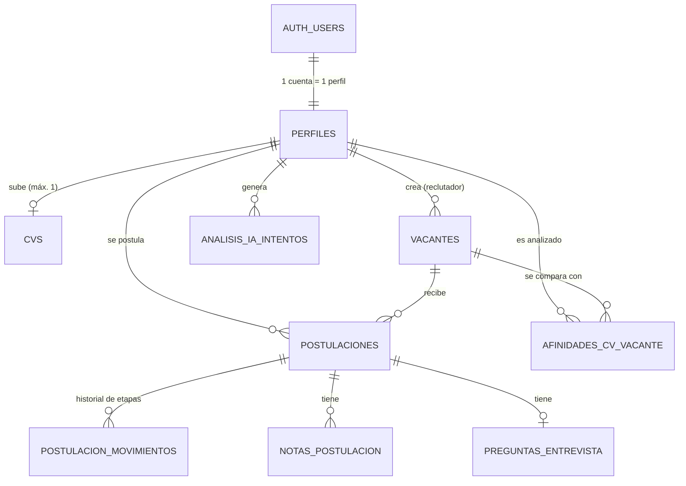
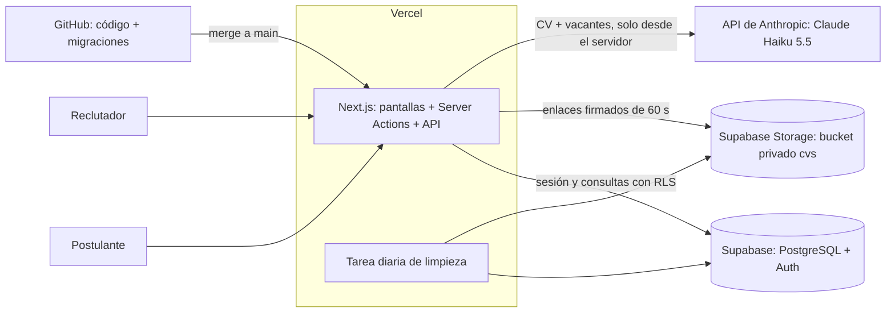

# Presentación técnica: Grupo Cumbre

Cuerpo de las 10 diapositivas, en el orden de la consigna.

---

## 1. Base de datos: modelo de datos

- La base es **PostgreSQL** (Supabase) y tiene **9 tablas**, todas con clave primaria `uuid`:
  - **perfiles**: una fila por cuenta (nombre, apellido, email y rol). Su `id` es el mismo de la cuenta de login.
  - **vacantes**: los puestos publicados por reclutadores.
  - **cvs**: el CV de cada postulante y su análisis. Un solo CV por persona.
  - **postulaciones**: una persona postulada a una vacante, con su etapa en el proceso.
  - **afinidades_cv_vacante**: resultado de la IA, la afinidad (0 a 100) y los motivos de cada CV con cada vacante abierta.
  - **postulacion_movimientos**: historial de cambios de etapa.
  - **notas_postulacion**: notas internas del equipo de selección.
  - **preguntas_entrevista**: preguntas sugeridas por la IA para una postulación.
  - **analisis_ia_intentos**: control del tope diario de análisis por persona.
- **Cómo se relacionan:**
  - Una cuenta tiene un perfil (1 a 1) y un perfil tiene como máximo un CV (1 a 0..1).
  - Vacantes y personas se relacionan de muchos a muchos, y esa relación se resuelve con la tabla `postulaciones`.
  - Una postulación tiene muchos movimientos y muchas notas (1 a N) y como máximo un set de preguntas.
- **Cómo nos aseguramos de no repetir datos:**
  - Claves únicas: nadie puede postularse dos veces a la misma vacante, ni tener dos CV, ni tener dos resultados de IA para la misma vacante.
  - Cada dato vive en un solo lugar. Los resultados de IA estaban en dos tablas y los unificamos en una sola.
  - Claves foráneas con borrado definido caso por caso: si se borra una vacante, se borran sus postulaciones y sus resultados; los CV y las personas quedan.
  - Restricciones de validez: la afinidad solo puede estar entre 0 y 100, las etapas y los roles solo admiten valores permitidos.
  - El email del perfil es una copia del email de la cuenta y un disparador lo mantiene sincronizado.

---

## 2. Hosting: dónde corre cada componente

- No tenemos servidores propios: todo corre en servicios en la nube.
- **Vercel** (plan Hobby): entrega las pantallas (Next.js) y ejecuta el backend como funciones del mismo proyecto (Server Actions y rutas API). También corre una tarea diaria de limpieza.
- **Supabase** (región us-east-1, PostgreSQL 17):
  - la base de datos (tablas, restricciones, disparadores y reglas de seguridad),
  - la autenticación (Supabase Auth),
  - el almacenamiento de archivos: bucket privado `cvs` con los PDF.
- **API de Anthropic** (Claude Haiku 5.5): analiza los CV, calcula la afinidad y genera las preguntas. Solo se la llama desde el servidor.
- **GitHub**: guarda el código y las migraciones de la base.
- **Cómo llega un cambio a producción:**
  1. Se trabaja en una rama y se sube a GitHub.
  2. Vercel, conectado al repositorio, genera un despliegue de **preview** por cada rama.
  3. Al hacer merge a `main`, Vercel compila y publica en **producción**. Si la compilación falla, sigue online la versión anterior.
  4. Los cambios de base de datos se escriben como **migraciones SQL versionadas** en `supabase/migrations` y se aplican en Supabase con un respaldo previo.
  5. Las claves se cargan como variables de entorno en Vercel. En el repositorio solo hay una plantilla (`.env.example`).

---

## 3. Seguridad: autenticación

- **Por qué es importante:** guardamos datos personales (nombre, email, CV) y hay dos roles con permisos distintos. Sin saber con certeza quién hace cada pedido, alguien podría leer datos ajenos o hacerse pasar por reclutador.
- **Autenticación** es comprobar quién es el usuario; **autorización** es decidir qué puede hacer. Las resolvemos con herramientas distintas.
- **Cómo resolvemos la autenticación:**
  - Usamos **Supabase Auth** en lugar de programar nuestro propio login: es una parte delicada y fácil de hacer mal.
  - Registro e inicio de sesión con email y contraseña. Las contraseñas nunca se guardan en texto plano, solo como hash.
  - Cada sesión recibe un **token JWT** con vencimiento y renovación automática. La sesión viaja en cookies.
  - Cada usuario tiene un identificador único que es el `id` de su fila en `perfiles`, donde está su rol.
  - Al registrarse, un disparador crea el perfil siempre como **postulante**. El rol de **reclutador** solo se asigna a mano desde el panel de Supabase: nadie puede elegirlo.
- **Cómo resolvemos la autorización, en tres capas:**
  1. Cada pantalla y cada acción verifican el rol en el servidor.
  2. **Row Level Security (RLS)**, activado en las 9 tablas: la base decide qué filas puede ver o modificar cada usuario según su token.
  3. **Permisos por columna**: por ejemplo, en `perfiles` el usuario solo puede editar nombre y apellido, nunca el rol.
- **Un problema que detectamos y corregimos:** la política de edición de perfiles permitía modificar cualquier columna, incluido el rol, y cualquier usuario podía volverse reclutador desde la consola del navegador. Lo solucionamos quitando el permiso general y dejando solo nombre y apellido.
- También usamos el **asesor de seguridad de Supabase**: señaló que una función de disparador era ejecutable desde la API y lo corregimos. Los avisos que quedan son intencionales (la función `es_reclutador()` la necesitan las políticas).
- La interfaz no es una barrera de seguridad: lo que protege los datos son las reglas del servidor y de la base.

---

## 4. Seguridad: backup y recovery

- **Qué es un backup:** una copia de los datos guardada en otro lugar y momento, para poder recuperarse de un borrado accidental, una falla, un ataque o un cambio que salió mal.
- **Nivel de criticidad: medio.** La plataforma tiene datos personales sensibles (CV), pero no es un sistema transaccional: si no está disponible unas horas, no hay pérdida económica inmediata.
- **Objetivos:** perder como máximo **un día** de datos (RPO de 24 horas) y volver a funcionar en **pocas horas** (RTO de 4 horas). **No requiere alta disponibilidad:** la disponibilidad que ofrecen Vercel y Supabase como servicios administrados es suficiente.
- **Cómo se respalda cada pieza:**
  - **Código y migraciones:** en GitHub, con todo el historial. Con eso se puede reconstruir la estructura de la base desde cero.
  - **Base de datos:** el proyecto usa el plan gratuito de Supabase, que no incluye backups automáticos. Por eso, antes de cada cambio de estructura hacemos un **respaldo manual**: una copia de las 9 tablas en un esquema aparte, con un control que compara la cantidad de filas de cada original con su copia. Para producción real, el plan es pasar a un plan con **backups diarios automáticos** y, si hace falta perder menos datos, recuperación a un punto en el tiempo.
  - **Archivos (CV):** los backups de la base no incluyen los archivos de Storage, así que se respaldan aparte, con una copia periódica del bucket.
  - **Claves y configuración:** se guardan en un gestor de contraseñas del equipo, nunca en el repositorio.
  - **Máquinas virtuales:** no hay, porque la solución es serverless. No hay servidores que respaldar.
- **Esquema de respaldo:**
  - backup diario automático, con retención de 7 a 30 días;
  - una copia semanal externa (volcado de la base y copia del bucket) en otro proveedor, con bloqueo de borrado para que sea inmutable;
  - prueba de restauración periódica: un backup que no se probó no es un backup;
  - regla 3-2-1: tres copias, en dos medios, una fuera del proveedor.

---

## 5. Seguridad: protección de datos que no están en la base

- **Los CV viven en un bucket privado de Supabase Storage:**
  - no es público,
  - solo acepta PDF de hasta 5 MB,
  - tiene 3 políticas de acceso (subir, reemplazar y leer) que limitan a cada persona a su propia carpeta; el reclutador puede leerlos.
- **Nunca hay un enlace público permanente.** Para ver un CV, el servidor comprueba la sesión y genera un enlace firmado que vence a los **60 segundos**.
- **Los resultados de IA, las notas y las preguntas** solo los puede leer el reclutador; el postulante no los ve ni siquiera consultando la API.
- **Integración con un tercero (la IA):**
  - el CV se envía a la API de Anthropic **solo desde el servidor**;
  - el postulante ve un aviso de privacidad antes de subir su CV;
  - se le indica a la IA que no use ni mencione datos personales sensibles (edad, género, nacionalidad, etc.) y que ignore instrucciones escondidas dentro del CV;
  - la IA orienta, no decide.
- **Rutas propias protegidas:** la tarea diaria de limpieza exige un secreto; sin él responde "no autorizado".
- **Se minimizan los datos retenidos:** la limpieza diaria borra los archivos que quedaron sin CV (por ejemplo, de cuentas eliminadas) y los registros viejos de análisis.
- **Límites de abuso:** tope diario de análisis por persona y tope de gasto mensual en Anthropic.
- La página pública se puede abrir sin cuenta de Vercel, pero los datos de la plataforma solo se ven iniciando sesión.

---

## 6. Seguridad en credenciales

- **Ninguna clave ni contraseña está en el código ni en GitHub.**
- Las claves viven en **variables de entorno**: en `.env.local` en la computadora de desarrollo (archivo excluido de Git) y en **Vercel → Environment Variables** en producción. En el repositorio solo existe `.env.example`, con valores de mentira.
- **Qué es público y qué es secreto:**
  - Públicas, por diseño: la URL de Supabase y la clave pública (publishable key). Por sí solas no dan acceso a nada, porque la seguridad real la ponen las reglas de la base.
  - Secretas, solo en el servidor: la clave secreta de Supabase (que se salta las reglas de seguridad), la clave de Anthropic y el secreto de la tarea diaria.
- Las secretas **no llevan el prefijo `NEXT_PUBLIC_`**, porque ese prefijo las enviaría al navegador. En Vercel están cargadas como tipo **Sensitive**: una vez guardadas no se pueden volver a leer.
- El archivo que usa la clave secreta de Supabase tiene la marca `server-only`: si alguien intentara usarlo desde una pantalla, la aplicación **no compila**.
- Los registros de errores nunca incluyen claves ni el contenido de los CV.
- Si una clave se filtrara, se revoca en el proveedor, se genera otra y se actualiza la variable en Vercel.

---

## 7. Buenas prácticas de programación

- **Capas bien separadas:**
  - **Pantallas** (`src/components`, `src/app`): muestran información y reciben clics. No tienen reglas de negocio.
  - **Acciones del servidor** (`src/lib/acciones`): todas las operaciones de escritura. Cada una verifica el rol antes de actuar (postularse, cambiar etapa, eliminar una vacante, etc.).
  - **Lógica de negocio y de IA** (`src/lib/ia`): análisis, afinidad, sugerencia de otra vacante y preguntas de entrevista.
  - **Acceso a datos** (`src/lib/dashboard.ts`, `src/lib/supabase`): carga de datos, paginación y clientes de Supabase.
  - **Base de datos**: restricciones, disparadores y reglas de seguridad como última línea de defensa.
- **Cada regla de negocio está en un solo lugar:**
  - los umbrales de la IA (qué es un buen match, cuántos candidatos mostrar, topes) están en un único archivo de configuración;
  - las etapas del proceso y los plazos de las alertas, en un único archivo;
  - la regla de "otra vacante sugerida" es una sola función que usan todas las pantallas;
  - el control de rol es una sola función que usan todas las acciones.
  Si cambia un criterio, se cambia en un solo lugar y toda la plataforma se actualiza.
- **Las reglas importantes también las protege la base** (etapas válidas, afinidad entre 0 y 100, historial de etapas, unicidad). Si el código fallara, la base igual lo impediría.
- **Backend y frontend diferenciados:**
  - las pantallas se generan en el servidor y los componentes del navegador solo invocan acciones del servidor;
  - no hay cálculos ni consultas a la base dentro de los componentes de interfaz;
  - el único acceso directo del navegador a Supabase es la subida del PDF al almacenamiento, limitada por las políticas del bucket.

---

## 8. Ambientes: DEV, QA y PROD

- **DEV (desarrollo):** donde se programa y se prueba rápido, y se puede romper. Es la computadora de cada integrante, con sus variables en `.env.local` y datos de prueba.
- **QA (pruebas):** donde se valida el cambio completo antes de publicarlo, en condiciones lo más parecidas posible a producción. Son los **despliegues de preview** de Vercel: cada rama genera su propia dirección para probar el cambio.
- **PROD (producción):** lo que usa la gente real, con datos reales y backups. Es la rama `main` en Vercel, y cada merge a `main` publica una nueva versión.
- **Cómo lo implementaríamos completo:**
  - un proyecto de Supabase por ambiente (desarrollo, QA y producción), cada uno con sus propias claves;
  - variables de entorno separadas por ambiente en Vercel (Development, Preview y Production), con claves distintas y topes de gasto de IA distintos;
  - flujo: rama de trabajo, preview contra QA, revisión y merge a `main` para llegar a producción;
  - las migraciones se escriben una vez, se prueban en DEV, se aplican en QA y recién después en PROD, siempre con respaldo previo;
  - los datos reales de producción no se copian a DEV ni a QA sin anonimizarlos.
- Ya aplicamos este criterio: la última modificación de la estructura de datos la probamos primero en una base PostgreSQL de prueba con datos de ejemplo, antes de tocar la real.

---

## 9. Escalabilidad: llevar el artefacto a muchos usuarios

- **Para llegar a miles de usuarios no hace falta cambiar de tecnología:** Vercel escala las funciones automáticamente y Supabase es PostgreSQL, que soporta mucho volumen. Lo que sí cambia son los **planes comerciales**.
- **Vercel:** hoy usa el plan Hobby (gratuito, para uso no comercial y de una sola persona). Para uso comercial y para trabajar entre varias personas se pasa al plan **Pro**.
- **Supabase:** hoy usa el plan Free, con límites de almacenamiento (base y archivos), de usuarios activos y con pausa del proyecto por inactividad. Para producción se pasa al plan **Pro**, que agrega más almacenamiento, backups diarios y elimina la pausa. Si el volumen sigue creciendo: más capacidad de cómputo, agrupación de conexiones y réplicas de lectura.
- **API de Anthropic:** el costo y la velocidad dependen de la cantidad de CV analizados. Se controlan con un modelo económico (Haiku), un tope diario por persona, un tope mensual de gasto y analizando cada CV una sola vez, cuando se sube. A gran escala se agregaría una cola de trabajos.
- **Qué ya está preparado para crecer:**
  - índices en las consultas más frecuentes;
  - carga de datos por páginas, porque Supabase devuelve como máximo 1000 filas por consulta;
  - el análisis de IA corre en segundo plano, sin hacer esperar al usuario;
  - límite de concurrencia y de cantidad de vacantes por análisis.
- **Si algún día hubiera que cambiar de tecnología, plan de migración de datos:**
  1. Planificar una ventana de mantenimiento o congelar las escrituras.
  2. Exportar la base con un volcado (`pg_dump`), que incluye estructura y datos, y restaurarla en el nuevo PostgreSQL (por ejemplo AWS RDS o Google Cloud SQL).
  3. Validar que las cantidades de filas coincidan, con la misma técnica del control de respaldo.
  4. Copiar los archivos del almacenamiento a un bucket equivalente (por ejemplo S3).
  5. Migrar los usuarios y la autenticación: viven en el esquema de autenticación de Supabase y hay que exportarlos o pasar a otro proveedor de identidad.
  6. Actualizar las variables de entorno y adaptar lo específico de Supabase (las reglas RLS dependen de la identidad del usuario y del cliente de almacenamiento).
  Como la base es PostgreSQL estándar y toda su estructura está en migraciones versionadas, lo más trabajoso de migrar no es la base, sino la autenticación, los archivos y las reglas de seguridad.

---

## 10. Stack tecnológico

- **TypeScript:** lenguaje de programación (JavaScript con tipos, para evitar errores).
- **Next.js 16 (App Router) y React 19:** framework con el que se construyen las pantallas y la lógica del servidor en un solo proyecto.
- **Tailwind CSS 4:** estilos y diseño adaptable a celular y escritorio.
- **Supabase:** el backend completo.
  - PostgreSQL: los datos.
  - Auth: los usuarios y las sesiones.
  - Storage: los CV.
  - RLS: los permisos.
  La librería `@supabase/ssr` conecta Next.js con la sesión de Supabase mediante cookies.
- **Anthropic, Claude Haiku 5.5:** inteligencia artificial que resume el CV, calcula la afinidad con cada vacante, sugiere otra vacante y genera preguntas de entrevista.
- **Zod:** valida que la respuesta de la IA tenga el formato esperado.
- **Vercel:** publicación de la aplicación, despliegue automático, funciones del servidor y la tarea diaria de limpieza.
- **GitHub:** repositorio, ramas, pull requests, historial de cambios y migraciones.
- **Claude Code:** asistente de IA que usamos para programar, probar y documentar. No forma parte de lo que corre en producción.
